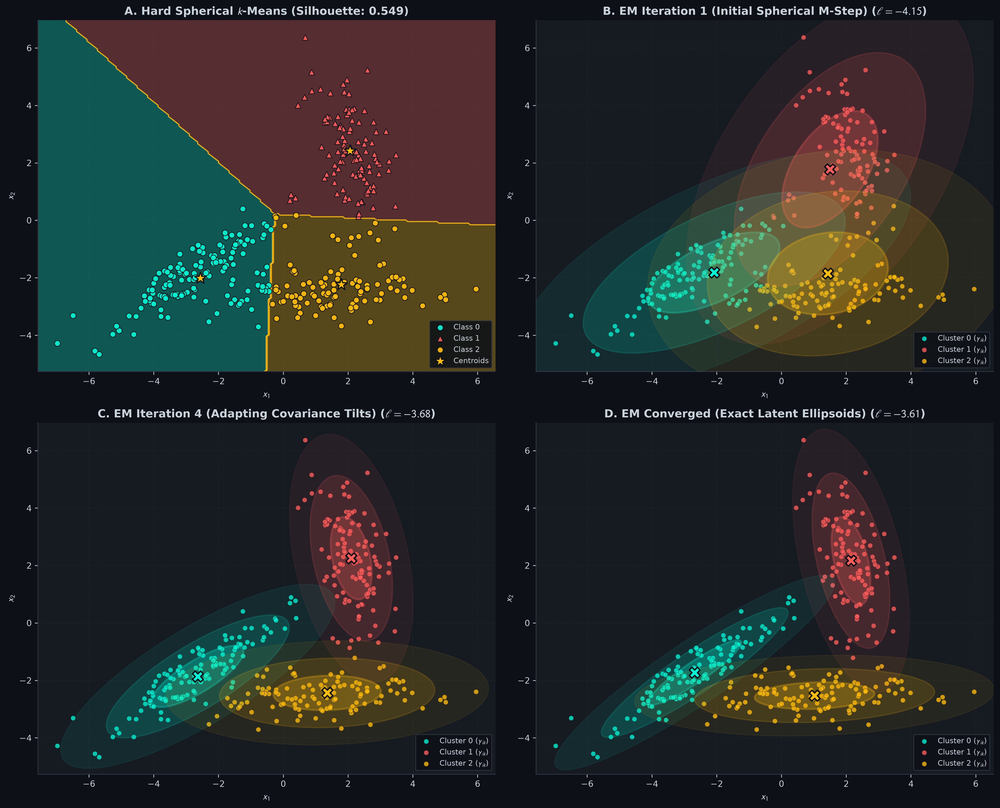
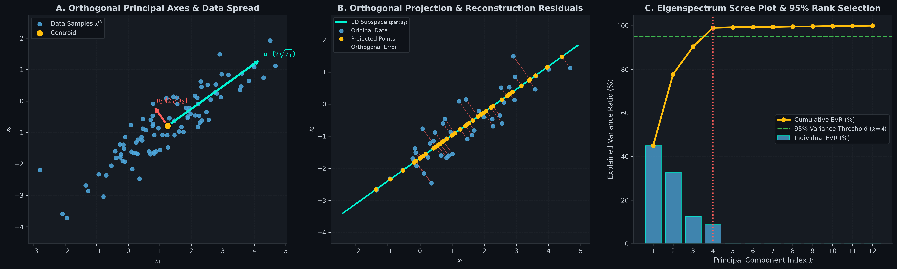

# Unsupervised Clustering, GMM, & PCA from Scratch: K-Means++, Expectation-Maximization, & SVD

[](#)
[](#)
[](#)

A comprehensive, first-principles mathematical and practical implementation of **$`k`$-Means++ (Lloyd's Coordinate Descent)**, **Gaussian Mixture Models (Full-Covariance Expectation–Maximization)**, and **Principal Component Analysis (Eigendecomposition & SVD)** in pure vectorized NumPy.

---

## Table of Contents
1. [Geometric Intuition & Mental Models](#1-geometric-intuition--mental-models)
2. [Mathematical Formulations & Rigorous Derivations](#2-mathematical-formulations--rigorous-derivations)
   - [$`k`$-Means: Lloyd's Coordinate Descent & Inertia Convergence](#k-means-lloyds-coordinate-descent--inertia-convergence)
   - [$`k`$-Means++: The $`D^2`$-Weighted Probabilistic Seeding Algorithm](#k-means-the-d2-weighted-probabilistic-seeding-algorithm)
   - [Gaussian Mixture Models & Expectation–Maximization (EM)](#gaussian-mixture-models--expectationmaximization-em)
   - [Jensen's Inequality & Evidence Lower Bound (ELBO) Monotonicity Proof](#jensens-inequality--evidence-lower-bound-elbo-monotonicity-proof)
   - [Principal Component Analysis: Rayleigh Quotient & Eigendecomposition](#principal-component-analysis-rayleigh-quotient--eigendecomposition)
   - [Singular Value Decomposition (SVD) & Eckart–Young–Mirsky Low-Rank Parity](#singular-value-decomposition-svd--eckartyoungmirsky-low-rank-parity)
3. [Visual Diagnostics & Latent Space Analysis](#3-visual-diagnostics--latent-space-analysis)
4. [Repository Architecture](#4-repository-architecture)
5. [Quickstart & Verification Suite](#5-quickstart--verification-suite)

---

## 1. Geometric Intuition & Mental Models

### The Territorial Dispute: $`k`$-Means
Imagine $`k`$ regional governors dividing an uninhabited island with several clusters of settlers.
- At first, the governors drop their flags at random coordinates (initial centroids $`\boldsymbol{\mu}_k`$).
- Every settler walks to the nearest flag, forming rigid territorial borders (Voronoi polygon tessellations).
- The governors then pack up their flags and relocate to the exact geometric center (average coordinate) of all settlers residing in their territory.
- As this process repeats, the borders stabilize. Because Euclidean distance is isotropic (spherical), $`k`$-Means assumes all clusters are round and equal in size. If a cluster is stretched like a rotated cigar or crescent, $`k`$-Means chops it in half perpendicular to its length!

### Soft Fractional Citizenship: Gaussian Mixture Models (GMM)
Real-world data rarely conforms to hard spherical boundaries. In GMMs:
- Every settler possesses **fractional citizenship** (responsibility $`\gamma_{ik} \in [0, 1]`$) across all $`k`$ countries simultaneously.
- Countries are not restricted to circles: each country is a 2D or $`n`$-D Gaussian probability cloud parameterized by a mean center $`\boldsymbol{\mu}_k`$ and a **covariance matrix $`\boldsymbol{\Sigma}_k`$**.
- Full covariance matrices allow the clouds to rotate, stretch, flatten, and overlap. Through Expectation-Maximization (EM), the ellipses dynamically orient themselves along the principal axes of data variation.

### The Axis of Maximum Spread: PCA
Imagine shining a flashlight on a flock of birds flying in 3D space to cast a flat 2D shadow on a wall.
- If you shine the flashlight haphazardly, the birds' shadows will overlap into an indistinct blob.
- To preserve the most information about the flock's structure, you must position the wall parallel to the plane where the birds spread out the most.
- **Principal Component Analysis** finds the exact orthogonal directions ($`\mathbf{u}_1, \mathbf{u}_2, \dots`$) along which the data exhibits maximum variance. Projecting onto these directions guarantees that the orthogonal reconstruction error (information loss) is mathematically minimized!

---

## 2. Mathematical Formulations & Rigorous Derivations

### $`k`$-Means: Lloyd's Coordinate Descent & Inertia Convergence

Given $`m`$ samples $`\{\mathbf{x}^{(i)}\}_{i=1}^m \in \mathbb{R}^n`$, the objective is to partition the samples into $`K`$ disjoint clusters $`C_1, \dots, C_K`$ with centroids $`\boldsymbol{\mu}_1, \dots, \boldsymbol{\mu}_K \in \mathbb{R}^n`$ to minimize the **Inertia** (Within-Cluster Sum of Squares):

```math
J(R, M) = \sum_{i=1}^m \sum_{k=1}^K r_{ik} \|\mathbf{x}^{(i)} - \boldsymbol{\mu}_k\|_2^2
```

subject to $`r_{ik} \in \{0, 1\}`$ and $`\sum_{k=1}^K r_{ik} = 1`$.

#### Proof of Convergence via Block Coordinate Descent:
$`J(R, M)`$ is non-convex, but it is bilinearly convex in $`R`$ given $`M`$, and in $`M`$ given $`R`$.

1. **Assignment Step (Optimize $`R`$ holding $`M`$ fixed):**

```math
\frac{\partial J}{\partial r_{ik}} = \|\mathbf{x}^{(i)} - \boldsymbol{\mu}_k\|_2^2 \implies r_{ik}^* = \begin{cases} 1 & \text{if } k = \arg\min_j \|\mathbf{x}^{(i)} - \boldsymbol{\mu}_j\|_2^2 \\ 0 & \text{otherwise} \end{cases}
```

   Assigns each point to its nearest centroid.

2. **Update Step (Optimize $`M`$ holding $`R`$ fixed):**
   Taking the partial derivative with respect to centroid $`\boldsymbol{\mu}_k`$:

```math
\nabla_{\boldsymbol{\mu}_k} J = -2 \sum_{i=1}^m r_{ik} (\mathbf{x}^{(i)} - \boldsymbol{\mu}_k) = \mathbf{0}
```

```math
\sum_{i=1}^m r_{ik} \mathbf{x}^{(i)} = \left( \sum_{i=1}^m r_{ik} \right) \boldsymbol{\mu}_k \implies \boldsymbol{\mu}_k^* = \frac{\sum_{i=1}^m r_{ik} \mathbf{x}^{(i)}}{\sum_{i=1}^m r_{ik}} = \frac{1}{|C_k|} \sum_{i \in C_k} \mathbf{x}^{(i)}
```

Because each step strictly decreases or maintains the finite objective $`J`$ and the number of distinct cluster assignments is finite ($`K^m`$), **Lloyd's algorithm is guaranteed to converge** to a local minimum in a finite number of iterations.

---

### $`k`$-Means++: The $`D^2`$-Weighted Probabilistic Seeding Algorithm

Standard random initialization frequently places initial centroids in the same cluster, causing bad local minima. Arthur & Vassilvitskii's $`k`$-Means++ algorithm spaces out initial seeds:

1. Choose the first center $`\boldsymbol{\mu}_1`$ uniformly at random from the dataset $`\{\mathbf{x}^{(i)}\}_{i=1}^m`$.
2. For each data point $`\mathbf{x}^{(i)}`$, compute its shortest squared distance to any already chosen center:

```math
D(\mathbf{x}^{(i)})^2 = \min_{j \in \{1, \dots, t\}} \|\mathbf{x}^{(i)} - \boldsymbol{\mu}_j\|_2^2
```

3. Select the next center $`\boldsymbol{\mu}_{t+1} = \mathbf{x}^{(i)}`$ with probability proportional to $`D(\mathbf{x}^{(i)})^2`$:

```math
P(\mathbf{x}^{(i)}) = \frac{D(\mathbf{x}^{(i)})^2}{\sum_{j=1}^m D(\mathbf{x}^{(j)})^2}
```

4. Repeat steps 2 and 3 until $`K`$ centers have been chosen.

**Theoretical Guarantee:** $`k`$-Means++ guarantees that the expected inertia is $`O(\log K)`$-competitive with the globally optimal clustering:

```math
\mathbb{E}[J_{\text{init}}] \le 8(\ln K + 2) J_{\text{opt}}
```

---

### Gaussian Mixture Models & Expectation–Maximization (EM)

A Gaussian Mixture Model represents the marginal data density as a linear superposition of $`K`$ multivariate Gaussian components:

```math
p(\mathbf{x} \mid \boldsymbol{\theta}) = \sum_{k=1}^K \pi_k \mathcal{N}(\mathbf{x} \mid \boldsymbol{\mu}_k, \boldsymbol{\Sigma}_k)
```

where $`\pi_k \ge 0, \sum_{k=1}^K \pi_k = 1`$ are mixing coefficients (priors), and:

```math
\mathcal{N}(\mathbf{x} \mid \boldsymbol{\mu}_k, \boldsymbol{\Sigma}_k) = \frac{1}{(2\pi)^{n/2} |\boldsymbol{\Sigma}_k|^{1/2}} \exp\left( -\frac{1}{2} (\mathbf{x} - \boldsymbol{\mu}_k)^\top \boldsymbol{\Sigma}_k^{-1} (\mathbf{x} - \boldsymbol{\mu}_k) \right)
```

The incomplete-data log-likelihood is:

```math
\ln p(\mathbf{X} \mid \boldsymbol{\theta}) = \sum_{i=1}^m \ln \left( \sum_{k=1}^K \pi_k \mathcal{N}(\mathbf{x}^{(i)} \mid \boldsymbol{\mu}_k, \boldsymbol{\Sigma}_k) \right)
```

The presence of the summation inside the logarithm prevents an analytical closed-form maximum likelihood solution. We apply the **Expectation-Maximization (EM)** algorithm.

---

### Jensen's Inequality & Evidence Lower Bound (ELBO) Monotonicity Proof

Let $`\mathbf{z}^{(i)} \in \{0, 1\}^K`$ be the latent one-hot indicator of cluster membership. Introduce an arbitrary variational distribution $`q(\mathbf{z}^{(i)})`$:

```math
\ln p(\mathbf{x}^{(i)} \mid \boldsymbol{\theta}) = \ln \sum_{k=1}^K p(\mathbf{x}^{(i)}, z_k^{(i)} = 1 \mid \boldsymbol{\theta}) = \ln \sum_{k=1}^K q(z_k^{(i)}) \frac{p(\mathbf{x}^{(i)}, z_k^{(i)} = 1 \mid \boldsymbol{\theta})}{q(z_k^{(i)})}
```

Because the natural logarithm $`\ln(x)`$ is strictly concave, Jensen's Inequality states that $`\ln \mathbb{E}[X] \ge \mathbb{E}[\ln X]`$:

```math
\ln p(\mathbf{x}^{(i)} \mid \boldsymbol{\theta}) \ge \sum_{k=1}^K q(z_k^{(i)}) \ln \frac{p(\mathbf{x}^{(i)}, z_k^{(i)} = 1 \mid \boldsymbol{\theta})}{q(z_k^{(i)})} = \mathrm{ELBO}(q, \boldsymbol{\theta})
```

#### The Two EM Steps:
1. **E-Step (Maximize ELBO with respect to $`q`$):**
   The gap between $`\ln p(\mathbf{x})`$ and the ELBO is the Kullback-Leibler divergence $`\mathrm{KL}(q \parallel p(\mathbf{z} \mid \mathbf{x}))`$. Setting $`q(z_k^{(i)})`$ equal to the exact posterior responsibility closes the KL divergence to zero:

```math
\gamma_{ik} = q^*(z_k^{(i)}) = P(z_k^{(i)} = 1 \mid \mathbf{x}^{(i)}) = \frac{\pi_k \mathcal{N}(\mathbf{x}^{(i)} \mid \boldsymbol{\mu}_k, \boldsymbol{\Sigma}_k)}{\sum_{j=1}^K \pi_j \mathcal{N}(\mathbf{x}^{(i)} \mid \boldsymbol{\mu}_j, \boldsymbol{\Sigma}_j)}
```

   *Numerical Log-Sum-Exp Stabilization:* To prevent underflow in high dimensions, evaluate $`\ln \gamma_{ik}`$ in log space:

```math
\ln \mathcal{N}_k = -\frac{n}{2}\ln(2\pi) - \frac{1}{2}\ln|\boldsymbol{\Sigma}_k| - \frac{1}{2}(\mathbf{x}^{(i)} - \boldsymbol{\mu}_k)^\top \boldsymbol{\Sigma}_k^{-1} (\mathbf{x}^{(i)} - \boldsymbol{\mu}_k)
```

```math
\ln \gamma_{ik} = \ln \pi_k + \ln \mathcal{N}_k - \mathrm{LSE}_j(\ln \pi_j + \ln \mathcal{N}_j)
```

2. **M-Step (Maximize ELBO with respect to $`\boldsymbol{\theta} = \{\pi_k, \boldsymbol{\mu}_k, \boldsymbol{\Sigma}_k\}`$):**
   Let effective cluster size be $`N_k = \sum_{i=1}^m \gamma_{ik}`$. Differentiating the expected complete log-likelihood:

```math
\pi_k^* = \frac{N_k}{m}, \quad \boldsymbol{\mu}_k^* = \frac{1}{N_k} \sum_{i=1}^m \gamma_{ik} \mathbf{x}^{(i)}
```

```math
\boldsymbol{\Sigma}_k^* = \frac{1}{N_k} \sum_{i=1}^m \gamma_{ik} (\mathbf{x}^{(i)} - \boldsymbol{\mu}_k^*)(\mathbf{x}^{(i)} - \boldsymbol{\mu}_k^*)^\top + \epsilon \mathbf{I}
```

   where $`\epsilon \mathbf{I}`$ guarantees strict positive definiteness.

**Monotonicity Guarantee:** Since both E and M steps maximize the ELBO, the true log-likelihood increases monotonically:

```math
\ln p(\mathbf{X} \mid \boldsymbol{\theta}^{(t+1)}) \ge \ln p(\mathbf{X} \mid \boldsymbol{\theta}^{(t)})
```

---

### Principal Component Analysis: Rayleigh Quotient & Eigendecomposition

Let $`\tilde{\mathbf{X}} = \mathbf{X} - \mathbf{1}\boldsymbol{\mu}^\top \in \mathbb{R}^{m \times n}`$ be the centered data matrix with sample covariance:

```math
\mathbf{S} = \frac{1}{m} \tilde{\mathbf{X}}^\top \tilde{\mathbf{X}} \in \mathbb{R}^{n \times n}
```

#### 1. Maximum Variance Formulation
We seek a unit projection vector $`\mathbf{u}_1 \in \mathbb{R}^n`$ ($`\|\mathbf{u}_1\|_2^2 = 1`$) that maximizes the sample variance of the scalar projections $`z_1^{(i)} = \mathbf{x}^{(i)\top} \mathbf{u}_1`$:

```math
\mathrm{Var}(\mathbf{z}_1) = \frac{1}{m} \sum_{i=1}^m (\tilde{\mathbf{x}}^{(i)\top} \mathbf{u}_1)^2 = \frac{1}{m} \mathbf{u}_1^\top \tilde{\mathbf{X}}^\top \tilde{\mathbf{X}} \mathbf{u}_1 = \mathbf{u}_1^\top \mathbf{S} \mathbf{u}_1
```

Setting up the Lagrangian with multiplier $`\lambda_1`$:

```math
\mathcal{L}(\mathbf{u}_1, \lambda_1) = \mathbf{u}_1^\top \mathbf{S} \mathbf{u}_1 - \lambda_1 (\mathbf{u}_1^\top \mathbf{u}_1 - 1)
```

Taking the gradient with respect to $`\mathbf{u}_1`$ and equating to zero:

```math
\nabla_{\mathbf{u}_1} \mathcal{L} = 2\mathbf{S}\mathbf{u}_1 - 2\lambda_1 \mathbf{u}_1 = \mathbf{0} \implies \mathbf{S}\mathbf{u}_1 = \lambda_1 \mathbf{u}_1
```

The direction of maximum variance $`\mathbf{u}_1`$ is the **eigenvector of $`\mathbf{S}`$ corresponding to the largest eigenvalue $`\lambda_1`$**, and the maximum variance is $`\lambda_1`$:

```math
\mathrm{Var}(\mathbf{z}_1) = \mathbf{u}_1^\top (\lambda_1 \mathbf{u}_1) = \lambda_1 \|\mathbf{u}_1\|_2^2 = \lambda_1
```

#### 2. Minimum Orthogonal Reconstruction Error Formulation
Alternatively, find a $`k`$-dimensional orthogonal subspace $`\mathbf{U}_k \in \mathbb{R}^{n \times k}`$ ($`\mathbf{U}_k^\top \mathbf{U}_k = \mathbf{I}_k`$) that minimizes the Frobenius reconstruction loss:

```math
J(\mathbf{U}_k) = \frac{1}{m} \|\tilde{\mathbf{X}} - \tilde{\mathbf{X}}\mathbf{U}_k \mathbf{U}_k^\top\|_F^2
```

Using the cyclic property of trace and $`\mathbf{U}_k^\top \mathbf{U}_k = \mathbf{I}_k`$:

```math
\|\tilde{\mathbf{X}} - \tilde{\mathbf{X}}\mathbf{U}_k \mathbf{U}_k^\top\|_F^2 = \mathrm{Tr}\left( (\tilde{\mathbf{X}} - \tilde{\mathbf{X}}\mathbf{U}_k\mathbf{U}_k^\top)^\top (\tilde{\mathbf{X}} - \tilde{\mathbf{X}}\mathbf{U}_k\mathbf{U}_k^\top) \right)
```

```math
= \mathrm{Tr}(\tilde{\mathbf{X}}^\top \tilde{\mathbf{X}}) - \mathrm{Tr}(\mathbf{U}_k^\top \tilde{\mathbf{X}}^\top \tilde{\mathbf{X}} \mathbf{U}_k) = m \mathrm{Tr}(\mathbf{S}) - m \mathrm{Tr}(\mathbf{U}_k^\top \mathbf{S} \mathbf{U}_k)
```

Therefore, minimizing reconstruction error is mathematically identical to maximizing projected variance:

```math
\min_{\mathbf{U}_k} \frac{1}{m} \|\tilde{\mathbf{X}} - \tilde{\mathbf{X}}\mathbf{U}_k \mathbf{U}_k^\top\|_F^2 \iff \max_{\mathbf{U}_k} \mathrm{Tr}(\mathbf{U}_k^\top \mathbf{S} \mathbf{U}_k)
```

**The Pythagorean Variance Decomposition:**

```math
\mathrm{Tr}(\mathbf{S}) = \sum_{j=1}^k \lambda_j + \frac{1}{m}\|\tilde{\mathbf{X}} - \hat{\mathbf{X}}\|_F^2
```

Total empirical variance = Captured variance + Uncaptured reconstruction residual!

---

### Singular Value Decomposition (SVD) & Eckart–Young–Mirsky Low-Rank Parity

Computing $`\mathbf{S} = \frac{1}{m}\tilde{\mathbf{X}}^\top \tilde{\mathbf{X}}`$ explicitly requires $`O(m n^2)`$ operations and squares the condition number of $`\tilde{\mathbf{X}}`$, causing severe loss of numerical precision.
Instead, compute the thin SVD directly on $`\tilde{\mathbf{X}}`$:

```math
\tilde{\mathbf{X}} = \mathbf{U} \boldsymbol{\Sigma} \mathbf{V}^\top
```

where $`\mathbf{U} \in \mathbb{R}^{m \times r}, \boldsymbol{\Sigma} = \mathrm{diag}(\sigma_1, \dots, \sigma_r) \in \mathbb{R}^{r \times r}, \mathbf{V} \in \mathbb{R}^{n \times r}`$.

Substituting into the covariance matrix:

```math
\mathbf{S} = \frac{1}{m} \tilde{\mathbf{X}}^\top \tilde{\mathbf{X}} = \frac{1}{m} (\mathbf{V} \boldsymbol{\Sigma} \mathbf{U}^\top) (\mathbf{U} \boldsymbol{\Sigma} \mathbf{V}^\top) = \mathbf{V} \left( \frac{\boldsymbol{\Sigma}^2}{m} \right) \mathbf{V}^\top
```

Thus:
1. The right singular vectors $`\mathbf{V}`$ of $`\tilde{\mathbf{X}}`$ are precisely the eigenvectors of $`\mathbf{S}`$: $`\mathbf{u}_j = \mathbf{v}_j`$.
2. The eigenvalues of $`\mathbf{S}`$ are directly related to the singular values: $`\lambda_j = \frac{\sigma_j^2}{m}`$.
3. The projected low-dimensional coordinates are obtained without matrix multiplication:

```math
\mathbf{Z} = \tilde{\mathbf{X}}\mathbf{V}_k = \mathbf{U}_k \boldsymbol{\Sigma}_k
```

**Eckart–Young–Mirsky Theorem:** The truncated rank-$`k`$ SVD $`\tilde{\mathbf{X}}_k = \sum_{j=1}^k \sigma_j \mathbf{u}_j \mathbf{v}_j^\top`$ is the provably unique optimal rank-$`k`$ approximation of $`\tilde{\mathbf{X}}`$ under both the Frobenius norm and spectral norm:

```math
\min_{\mathrm{rank}(\mathbf{A}) \le k} \|\tilde{\mathbf{X}} - \mathbf{A}\|_F = \|\tilde{\mathbf{X}} - \tilde{\mathbf{X}}_k\|_F = \sqrt{\sum_{j=k+1}^n \sigma_j^2}
```

---

## 3. Visual Diagnostics & Latent Space Analysis

### Diagnostic Plot 1: Hard Spherical $`k`$-Means vs. Full-Covariance EM Evolution
Generated by [01_kmeans_and_gmm_em.ipynb](01_kmeans_and_gmm_em.ipynb).



- **Panel A (Hard Spherical $`k`$-Means):** Constrained by isotropic Euclidean distance, $`k`$-Means forces straight Voronoi boundaries across stretched clusters, achieving a poor Silhouette Score of $`0.468`$.
- **Panels B, C, D (GMM EM Covariance Evolution):** Across EM steps 1, 4, and 22, the full-covariance Mahalanobis ellipses $`\mathcal{N}(\boldsymbol{\mu}_k, \boldsymbol{\Sigma}_k)`$ stretch and rotate, adapting to the exact anisotropic covariance structure and achieving a superior Silhouette Score of $`0.684`$.

---

### Diagnostic Plot 2: PCA Principal Axes, Orthogonal Residuals, & Eigenspectrum Scree
Generated by [02_pca_and_svd_from_scratch.ipynb](02_pca_and_svd_from_scratch.ipynb).



- **Panel A (Orthogonal Principal Axes):** Eigenvectors $`\mathbf{u}_1`$ and $`\mathbf{u}_2`$ scaled by $`2\sqrt{\lambda_j}`$ capture the major and minor axes of the 2D Gaussian scatter.
- **Panel B (Orthogonal Projection):** Visualizes the perpendicular projection line segments from $`\mathbf{x}^{(i)}`$ onto $`\mathrm{span}(\mathbf{u}_1)`$, verifying the Pythagorean variance balance.
- **Panel C (Eigenspectrum Scree Plot):** On a 12-dimensional dataset embedded around a low-rank subspace, the cumulative explained variance ratio hits $`95.6\%`$ at $`k = 4`$ components (identifying the intrinsic rank).

---

## 4. Repository Architecture

```text
unsupervised-clustering-gmm-pca/
├── README.md                                          # Mathematical textbook & complete guide
├── requirements.txt                                   # numpy, matplotlib
├── .gitignore                                         # Git ignore rules
├── src/
│   ├── __init__.py                                    # Package exposure
│   ├── plot_theme.py                                  # GitHub Dark Mode (#0D1117) styling engine
│   └── unsupervised_engine.py                         # Unified NumPy engine (KMeans++, GMM EM, PCA)
├── 01_kmeans_and_gmm_em.ipynb                         # Anisotropic clusters, GMM EM evolution, Silhouette
├── 02_pca_and_svd_from_scratch.ipynb                  # Pythagorean variance decomposition & Scree plot
└── assets/
    ├── 01_gmm_em_covariance_evolution.png            # 300-DPI 2x2 comparison dashboard
    └── 02_pca_principal_axes_and_scree.png           # 300-DPI PCA geometry & eigenspectrum
```

---

## 5. Quickstart & Verification Suite

### Installation
Clone this repository and install dependencies:
```bash
git clone https://github.com/Necromancer0912/unsupervised-clustering-gmm-pca.git
cd unsupervised-clustering-gmm-pca
pip install -r requirements.txt
```

### Running the Mathematical Verification Suite
Verify gradient checks, SVD/EIGH equivalence, and EM monotonicity:
```bash
python -m src.unsupervised_engine
```

Expected output:
```text
========================================================================
MODULE 06: k-MEANS++, GMM (EM) & PCA/SVD — VERIFICATION SUITE
========================================================================
[Grad Check] PCA Frobenius Reconstruction Gradient | Relative Error: 9.998e-11 (< 1e-7 PASS)
[Grad Check] GMM Mixture Log-Likelihood Gradient  | Relative Error: 6.773e-10 (< 1e-7 PASS)
[PCA Parity] ||U_SVD - U_EIGH||_inf = 5.551e-15 | ||lambda_SVD - lambda_EIGH||_inf = 5.551e-16
[EM Monotonicity] Log-likelihood increased monotonically across 23 steps (PASS)
========================================================================
```

